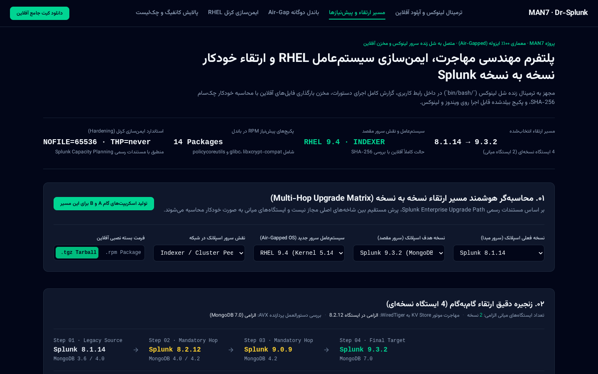
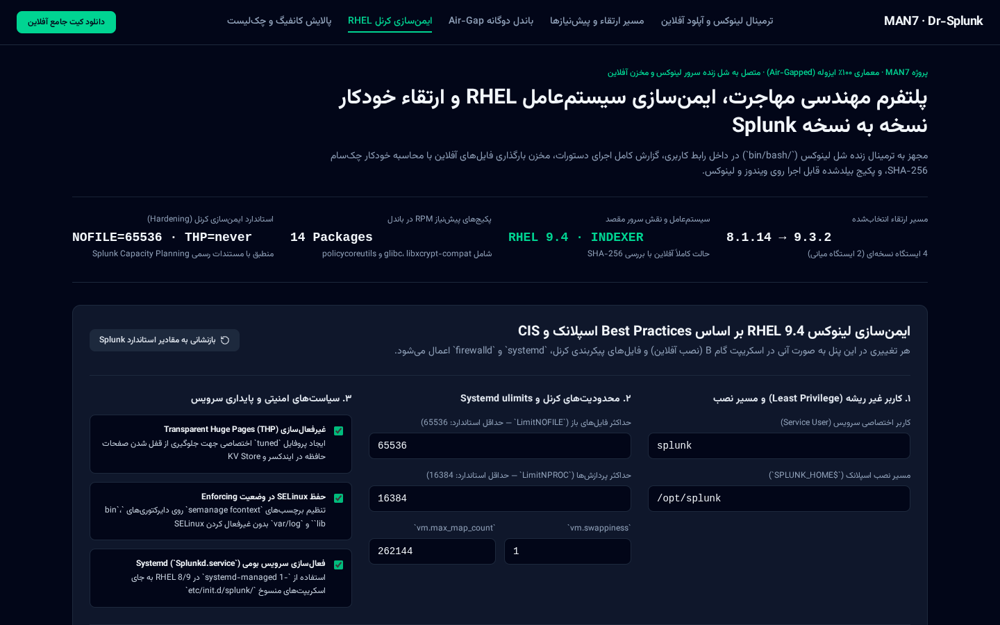
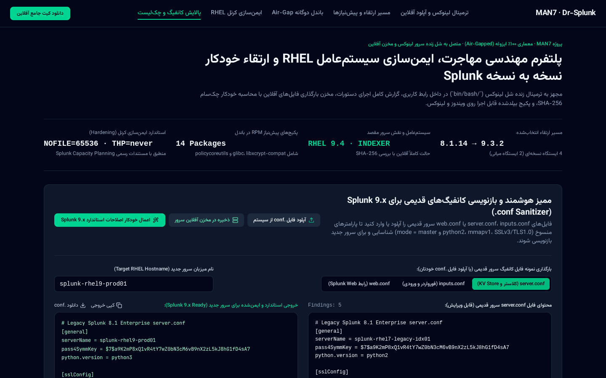
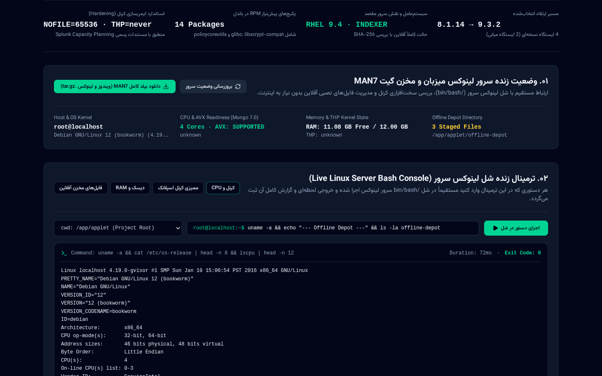

# راهنمای جامع تصویری و کاربردی سامانه MAN7 (اجرای بدون نصب و بدون نیاز به Admin روی ویندوز)

پلتفرم مهندسی مهاجرت، ارتقاء خودکار نسخه به نسخه Splunk و ایمن‌سازی لینوکس RHEL در محیط ایزوله (Air-Gapped).

---

## ۰. نحوه اجرا روی ویندوز (بدون نیاز به دسترسی Admin، بدون npm، بدون Node و بدون Java)

تمام فایل‌های گرافیکی و اجرایی برنامه از قبل بیلد (Build) شده و در پوشه **`windows-portable/`** داخل گیت قرار داده شده‌اند:

1. **اجرای کامل با یک کلیک (`start-windows.bat`)**:
   - کافی است روی فایل **`start-windows.bat`** دابل‌کلیک کنید.
   - این لانچر هیچ نیازی به `npm`، `Node.js`، `Java` یا دسترسی `Administrator` ندارد و با استفاده از موتور **Built-in خود ویندوز (`.NET TcpListener` و `PowerShell`)** برنامه را روی آدرس `http://127.0.0.1:3000` بالا می‌آورد.
2. **اجرای مستقیم بدون اسکریپت (`windows-portable/ui/index.html`)**:
   - همچنین می‌توانید مستقیماً فایل **`windows-portable/ui/index.html`** را در مرورگر Edge یا Chrome باز کنید.

---

## ۱. ترتیب منطقی مراحل کار در نرم‌افزار (۴ گام اصلی + بخش مجزای اتصال به پورت Root سرور)

### گام ۱: محاسبه‌گر مسیر ارتقاء و پیش‌نیازها (ابتدا محاسبه کنید چه می‌خواهید)
- قبل از ساختن اسکریپت یا نصب، نسخه فعلی اسپلانک و نسخه مقصد را انتخاب کنید.
- سیستم‌عامل سرور جدید (مثلاً `RHEL 9.4`) را مشخص کنید.
- سامانه به صورت خودکار تمام ایستگاه‌های میانی اجباری (مثلاً `8.2.12` و `9.0.9`) و ۱۴ پکیج پیش‌نیاز لینوکس را محاسبه می‌کند.
- در پایان روی دکمه **«ادامه به گام ۲: ایمن‌سازی کرنل RHEL»** کلیک کنید.

---

### گام ۲: ایمن‌سازی کرنل لینوکس RHEL (تنظیم پارامترهای سیستم‌عامل پیش از تولید اسکریپت)
- تنظیمات بهینه‌سازی و امنیتی هسته لینوکس را بررسی و تایید کنید:
  - خاموش کردن `Transparent Huge Pages (THP = never)` برای جلوگیری از افت ۳۰٪ سرعت اسپلانک.
  - افزایش سقف فایل‌های باز به `NOFILE = 65536`.
  - باز کردن پورت‌های استاندارد اسپلانک در `firewalld` و اعمال سیاست‌های `SELinux`.
- این تنظیمات مستقیماً وارد اسکریپت‌های گام ۳ می‌شوند.

---

### گام ۳: دریافت اسکریپت‌های گام A و B (شامل نسخه Built-in ویندوز) و آپلود مستقیم به مسیر نصب سرور
- اکنون که گام ۱ و ۲ محاسبه شدند، اسکریپت‌های آماده اجرا در اختیار شماست:
  1. **گام A لینوکس (`step_a_online_collector.sh`)** یا **گام A ویندوز Built-in (`step_a_windows_builtin.ps1`)**: اجرا روی سیستم دارای اینترنت برای دانلود فایل‌ها و ساخت باندل `man7-offline-kit.tar.gz` (نسخه ویندوز فقط از ابزارهای پیش‌فرض ویندوز بدون نیاز به Admin استفاده می‌کند).
  2. **بکاپ سرور قدیمی (`step_pre_legacy_splunk_backup.sh`)**: کپی تنظیمات و فایل حیاتی `splunk.secret`.
  3. **گام B (`step_b_offline_rhel_deployer.sh`)**: استقرار ۱۰۰٪ آفلاین روی سرور جدید.
- **آپلود مستقیم روی سرور در مسیر نصب**:
  - پس از دانلود فایل‌های آفلاین روی سیستم خود، از کادر **«آپلود مستقیم نسخه آفلاین روی سرور مقصد (در مسیر دقیق نصب)»** در همین صفحه، فایل‌ها را مستقیماً به پوشه `/var/tmp` یا `/opt/splunk-airgap` سرور بفرستید و با دکمه‌های **«تست سلامت فایل‌ها»** و **«اجرای اسکریپت گام B روی سرور»** عملیات نصب و تست را انجام دهید.

---

### گام چهارم: پالایشگر هوشمند فایل‌های کانفیگ (`.conf Sanitizer`) و چک‌لیست تست
- فایل‌های `.conf` سرور قدیم را آپلود کنید تا دستورات منسوخ (مانند `python2`، `mmapv1` و `SSLv3`) شناسایی و با یک کلیک به استاندارد Splunk 9.x تبدیل شوند.

---

## ۲. بخش مجزا در بالای صفحه: اتصال پورت Root و ترمینال سرور

برای اینکه نرم‌افزار MAN7 بتواند مستقیماً وارد سرور مقصد شود، دسترسی `root` بگیرد و فایل‌ها را در مسیر نصب کپی و اجرا کند، دکمه مجزای **«اتصال پورت Root و ترمینال سرور»** در بالای صفحه قرار داده شده است:

1. یک شماره پورت دلخواه (مثلاً `9099`) انتخاب کنید.
2. تک‌دستور آماده‌شده در کادر سمت چپ را کپی کرده و یک‌بار روی سرور لینوکس خود اجرا کنید تا پورت `9099` باز شود و شل `/bin/bash` با دسترسی `root` (با استفاده از `/usr/libexec/platform-python` که به صورت پیش‌فرض داخل هسته RHEL 8/9 وجود دارد) در اختیار این پورت قرار گیرد.
3. آی‌پی سرور و پورت `9099` را در UI وارد کرده و روی **«اتصال به پورت و دریافت دسترسی Root»** کلیک کنید.

